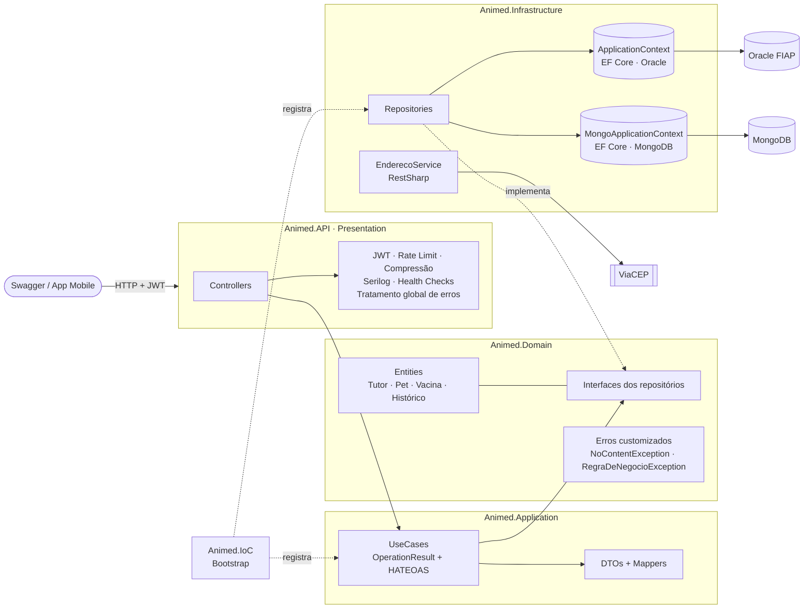
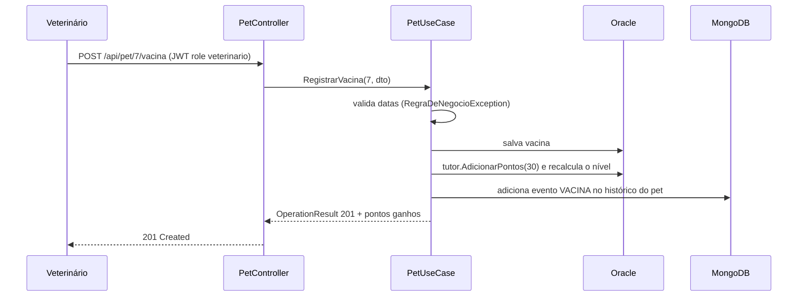

# 🐾 Animed API (.NET)

API REST em **ASP.NET Core 8** do Animed, a plataforma de **cuidado contínuo do pet** criada para o Challenge FIAP 2026 em parceria com a **Clyvo VET**.

O tutor ganha pontos a cada cuidado com o pet (vacina, consulta, pesagem). Com pontos ele sobe de nível e recebe desconto nos parceiros. Esta API cuida de:

- **Tutores, pets e vacinas** no **Oracle**, com Entity Framework Core e migrations.
- **Linha do tempo de cuidados** de cada pet no **MongoDB**, com documentos e eventos embutidos.
- **Pontuação:** registrar uma vacina credita **30 pontos** ao tutor e recalcula o nível (BASICO → CUIDADOR → TUTOR_PREMIUM).

---

## 👥 Squad Animed

| Integrante | RM |
|------------|-----|
| **Kaiky de Oliveira Silva** (líder) | 566067 |
| Erick Bernardes Bradaschia | 565733 |
| Gabriel Santos Claudino | 564054 |
| Jonathan Moreira Gomes | 565060 |
| Lucas Fortes de Lima | 559523 |

**Vídeo de demonstração:** _(link do YouTube)_

---

## 🏛️ Arquitetura

Clean Architecture com cinco projetos. As dependências apontam sempre para o **Domain**:



| Projeto | Responsabilidade |
|---|---|
| `Animed.Domain` | Entidades e regras puras: `TutorEntity.AdicionarPontos`, `NivelTutor.Calcular`, `VacinaEntity.Vencida`. Também as interfaces dos repositórios, os erros customizados e o `OperationResult<T>`. |
| `Animed.Application` | Casos de uso que orquestram os repositórios e devolvem `OperationResult` com o status HTTP. Também os DTOs de entrada e saída, os mappers e os links HATEOAS. |
| `Animed.Infrastructure` | Os dois `DbContext` (Oracle e MongoDB), os repositórios concretos, o serviço externo ViaCEP, os health checks e as migrations. |
| `Animed.IoC` | `Bootstrap.AddIoC`: registra contextos, repositórios e casos de uso na injeção de dependência. |
| `Animed.API` | Controllers, Swagger com exemplos, JWT, rate limiting, compressão, Serilog, health checks e o tratamento global de exceções. |

### Fluxo principal: registrar uma vacina



Se o MongoDB estiver fora do ar, a vacina e os pontos continuam salvos no Oracle. A falha fica registrada como *warning* no log.

### Persistência poliglota

| Dado | Banco | Por quê |
|---|---|---|
| Usuários, tutores, pets, vacinas | **Oracle** (`tb_net_*`) | Cadastro central com chaves estrangeiras, índice único de e-mail e integridade referencial. |
| Histórico de cuidados | **MongoDB** (`historico_cuidado`) | Linha do tempo que só cresce. Cada pet tem um documento e seus eventos embutidos, lidos de uma vez, sem JOIN. |

Exemplo de documento no MongoDB:

```json
{
  "_id": "6721c0f2a9e4b1d3c8f0a111",
  "PetId": 7,
  "TutorId": 3,
  "NomePet": "Thor",
  "Eventos": [
    { "Tipo": "VACINA", "Descricao": "Vacina V10 aplicada", "Pontos": 30, "Data": "2026-10-30T14:00:00Z" },
    { "Tipo": "PESAGEM", "Descricao": "28 kg", "Pontos": 5, "Data": "2026-10-31T10:00:00Z" }
  ]
}
```

---

## 🔌 Endpoints

O Swagger fica em **`/swagger`**, com descrição, exemplos e respostas de cada rota. Para autenticar, gere o token em `POST /api/auth` e cole no botão **Authorize**.

### Autenticação e usuários

| Método | Rota | Acesso | Descrição |
|---|---|---|---|
| POST | `/api/auth` | público (5 req/20s) | Gera o JWT (8h) com a role do usuário |
| POST | `/api/user` | admin | Cria usuário (tutor, veterinario, admin) |

### Tutores (Oracle)

| Método | Rota | Acesso | Descrição |
|---|---|---|---|
| GET | `/api/tutor` | admin, veterinario | Lista paginada com filtros e ordenação |
| GET | `/api/tutor/{id}` | autenticado | Um tutor com pontos, nível e links |
| POST | `/api/tutor` | admin, veterinario | Cadastra (começa com 0 pts, BASICO) |
| PUT | `/api/tutor/{id}` | autenticado | Edita |
| DELETE | `/api/tutor/{id}` | admin | Remove o tutor e, em cascata, os pets e vacinas |
| GET | `/api/tutor/endereco/{cep}` | público (10 req/30s) | Endereço pelo ViaCEP (serviço externo) |

### Pets e vacinas (Oracle)

| Método | Rota | Acesso | Descrição |
|---|---|---|---|
| GET | `/api/pet` | autenticado | Lista paginada com filtros e ordenação |
| GET | `/api/pet/{id}` | autenticado | Pet com vacinas e links |
| POST | `/api/pet` | autenticado | Cadastra pet |
| PUT | `/api/pet/{id}` | autenticado | Edita |
| DELETE | `/api/pet/{id}` | admin, veterinario | Remove |
| POST | `/api/pet/{petId}/vacina` | admin, veterinario | Registra vacina, credita 30 pts e grava no histórico |
| DELETE | `/api/pet/{petId}/vacina/{vacinaId}` | admin, veterinario | Remove vacina |

### Histórico de cuidados (MongoDB)

| Método | Rota | Acesso | Descrição |
|---|---|---|---|
| GET | `/api/historico` | autenticado | Lista paginada (filtro `TutorId`) |
| GET | `/api/historico/{id}` | autenticado | Um documento pelo ObjectId |
| GET | `/api/historico/pet/{petId}` | autenticado | Linha do tempo do pet, do mais recente ao mais antigo |
| POST | `/api/historico/pet/{petId}/evento` | admin, veterinario | Adiciona um evento embutido |
| DELETE | `/api/historico/{id}` | admin | Remove o documento |

### Paginação, filtros e ordenação

```
GET /api/tutor?Deslocamento=0&RegistroRetornado=10&Nome=mari&Nivel=CUIDADOR&OrdenarPor=pontos&Decrescente=true
GET /api/pet?TutorId=3&Especie=GATO&OrdenarPor=peso
```

| Parâmetro | Uso |
|---|---|
| `Deslocamento`, `RegistroRetornado` | paginação por offset (padrão 0 e 10) |
| `Nome` | trecho do nome, sem diferenciar maiúsculas |
| `Nivel` (tutor), `Especie` e `TutorId` (pet) | filtros exatos |
| `OrdenarPor` | tutor: `nome`, `pontos`, `id` · pet: `nome`, `peso`, `id` |
| `Decrescente` | `true` inverte a ordem |

### HATEOAS

Toda consulta devolve `links`. Nas listas também vêm `next_page` e `previous_page` quando existem.

```json
{
  "items": [
    {
      "id": 7, "nome": "Thor", "especie": "CACHORRO", "tutorId": 3,
      "vacinas": [ { "id": 1, "nomeVacina": "V10", "vencida": false } ],
      "links": [
        { "href": "/api/pet/7", "rel": "get_um_pet", "method": "GET" },
        { "href": "/api/pet/7", "rel": "update_pet", "method": "PUT" },
        { "href": "/api/pet/7", "rel": "delete_pet", "method": "DELETE" },
        { "href": "/api/pet/7/vacina", "rel": "registrar_vacina", "method": "POST" },
        { "href": "/api/historico/pet/7", "rel": "historico_de_cuidados", "method": "GET" },
        { "href": "/api/tutor/3", "rel": "tutor", "method": "GET" }
      ]
    }
  ],
  "deslocamento": 0, "registroRetornado": 10, "totalRegistros": 12,
  "links": [
    { "href": "/api/pet?Deslocamento=0&RegistroRetornado=10", "rel": "self", "method": "GET" },
    { "href": "/api/pet", "rel": "create_pet", "method": "POST" },
    { "href": "/api/pet?Deslocamento=10&RegistroRetornado=10", "rel": "next_page", "method": "GET" }
  ]
}
```

### Respostas e erros

Os casos de uso devolvem `OperationResult<T>`, e o controller só repassa o status:

| Situação | Status |
|---|---|
| Consulta ou edição com sucesso | 200 |
| Criação | 201 |
| Lista vazia | 204 |
| Validação do DTO ou regra de negócio (`RegraDeNegocioException`) | 400 |
| Sem token ou login inválido | 401 |
| Role sem permissão | 403 |
| Registro não encontrado (`NoContentException`) | 404 |
| E-mail já cadastrado | 409 |
| Excesso de requisições (rate limit) | 429 |
| Erro inesperado (tratamento global, com `rastreio` para achar no log) | 500 |

---

## 📈 Monitoramento e observabilidade

### Health checks

| Rota | O que verifica |
|---|---|
| `GET /health/live` | A API está de pé (liveness) |
| `GET /health/db` | Oracle e MongoDB (readiness) |
| `GET /api/health/live` | Liveness em JSON detalhado |
| `GET /api/health/db` | Cada banco com status, descrição e erro |
| `GET /api/health/externo` | Disponibilidade do ViaCEP (`Degraded` se cair) |

```json
{
  "status": "Healthy",
  "duracaoMs": 412.7,
  "checks": [
    { "name": "oracle", "status": "Healthy", "description": null, "error": null },
    { "name": "mongodb", "status": "Healthy", "description": "MongoDB respondendo (3 históricos)", "error": null }
  ]
}
```

### Logging estruturado (Serilog)

- Logs no **console** e em **arquivo diário** (`logs/api-AAAAMMDD.log`, guardados por 7 dias).
- Níveis: **Information** para fluxo normal (cadastros, vacinas), **Warning** para buscas vazias, login inválido e falha do MongoDB, **Error** para exceções.
- `UseSerilogRequestLogging` registra cada requisição com método, rota, status e tempo de resposta. O `RequestId` correlaciona as linhas de uma mesma requisição.

### Tracing e métricas

O **Application Insights** (Azure Monitor + OpenTelemetry) liga quando `ApplicationInsights:ConnectionString` está configurada. Ele rastreia as requisições entre as camadas, as chamadas ao Oracle, ao MongoDB e ao ViaCEP, e mostra tempo de resposta e taxa de erros. Sem a connection string, a API roda normalmente, só sem telemetria.

---

## ▶️ Como executar

### Pré-requisitos

- .NET SDK 8
- Docker (para o MongoDB local)
- Acesso ao Oracle da FIAP

### 1. MongoDB

```bash
docker run -d --name mongo-animed -p 27017:27017 mongo:7
```

### 2. Configuração

Em `Animed.API/appsettings.Development.json`, troque `SEU_RM` e `SUA_SENHA` pelo usuário do Oracle da FIAP e defina uma `Secretkey` com 32 caracteres ou mais. Para não gravar a senha no arquivo, use variáveis de ambiente:

```bash
export ConnectionStrings__Oracle="Data Source=(DESCRIPTION=(ADDRESS_LIST=(ADDRESS=(PROTOCOL=TCP)(HOST=oracle.fiap.com.br)(PORT=1521)))(CONNECT_DATA=(SERVER=DEDICATED)(SID=ORCL)));User Id=RM000000;Password=******;"
export Secretkey="uma-chave-secreta-com-pelo-menos-32-caracteres"
```

### 3. Banco Oracle (migrations)

```bash
dotnet tool install --global dotnet-ef --version 8.0.10   # se ainda não tiver
dotnet ef database update --project Animed.Infrastructure --startup-project Animed.API --context ApplicationContext
```

A migration `initdb` cria `tb_net_usuario`, `tb_net_tutor`, `tb_net_pet` e `tb_net_vacina`, com índices e chaves estrangeiras em cascata. Ela também cadastra os usuários de demonstração. Como há dois `DbContext`, sempre informe `--context ApplicationContext`. O MongoDB não usa migrations.

### 4. Subir a API

```bash
dotnet run --project Animed.API --urls http://localhost:5080
```

Acesse **http://localhost:5080/swagger**.

### Usuários de demonstração

| E-mail | Senha | Role |
|---|---|---|
| admin@animed.com.br | animed123 | admin |
| doutor@animed.com.br | animed123 | veterinario |
| tutor@animed.com.br | animed123 | tutor |

---

## 🧪 Testes

```bash
dotnet test
```

São **47 testes** com xUnit, Moq e o padrão **AAA** (Arrange, Act, Assert). Os nomes seguem `Metodo_Cenario_ResultadoEsperado`.

| Projeto | Camada | O que cobre |
|---|---|---|
| `Animed.Tests.Unit/Domain` | Domínio | Pontos e níveis do tutor, limites de faixa com `[Theory]` e vacina vencida |
| `Animed.Tests.Unit/Application` | Aplicação | Casos de uso com repositórios mockados (Moq): status do `OperationResult`, links HATEOAS, `next_page`, vacina creditando pontos e gravando histórico, Mongo fora do ar, JWT com role |
| `Animed.Tests.Unit/Infrastructure` | Repositórios | EF Core InMemory: filtros, ordenação, paginação, e-mail duplicado, recálculo de nível |
| `Animed.Tests.Integration` | API | `WebApplicationFactory` com o pipeline real: 401 sem token, 403 por role, 200 com HATEOAS, 404, 400 de validação, 201 de vacina, 204, login inválido, health check |

**Fixtures:**
- `BancoEmMemoriaFixture`, compartilhado com `[Collection("BancoEmMemoria")]`, cria um banco em memória isolado por teste.
- `AnimedApiFactory`, compartilhado com `[Collection("Api")]`, sobe a API uma vez e gera JWT por role.

Para rodar só uma parte:

```bash
dotnet test Animed.Tests.Unit
dotnet test Animed.Tests.Integration
dotnet test --filter "Trait=UseCase"
```

---

## 🧰 Stack

| Tecnologia | Uso |
|---|---|
| ASP.NET Core 8 (Controllers) | API REST |
| Entity Framework Core 8 + Oracle.EntityFrameworkCore | Persistência relacional e migrations (compatibilidade Oracle 19c) |
| MongoDB.EntityFrameworkCore | Persistência NoSQL com o mesmo padrão de `DbContext` |
| JWT Bearer | Autenticação e autorização por roles |
| Swashbuckle + Annotations + Filters | Swagger com descrições e exemplos |
| Serilog | Logging estruturado (console e arquivo) |
| AspNetCore.HealthChecks.Oracle | Health check do Oracle |
| Azure Monitor OpenTelemetry | Tracing e métricas (Application Insights) |
| RestSharp | Consumo do ViaCEP |
| Rate Limiter e Response Compression (Brotli/Gzip) | Proteção e desempenho |
| xUnit, Moq, EF Core InMemory, Mvc.Testing | Testes unitários e de integração |

---

## 🗂️ Estrutura

```
Animed.sln
├── Animed.Domain/            Entities · Errors · Interfaces
├── Animed.Application/       Dtos · Mappers · Interfaces · UseCases
├── Animed.Infrastructure/    Data (Contexts, Repositories, Migrations) · Service · HealthChecks
├── Animed.IoC/               Bootstrap
├── Animed.API/               Controllers · Config · Doc/Samples · Program.cs
├── Animed.Tests.Unit/        Domain · Application · Infrastructure · Fixtures
└── Animed.Tests.Integration/ Controllers · Fixtures
```
